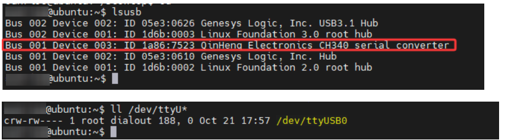

# RDK系列

## 1\.Gerät verbinden

Dieses Tutorial verwendet das Image der Version des RDK X5 Mainboards als Beispiel.

Stecken Sie den IMU-Lagesensor über ein Type\-C-Kabel in den USB-Anschluss der Hauptsteuerung.


## 2\.Gerätestatus anzeigen

Geräte-ID anzeigen

```PowerShell
lsusb
```

Gerätenummer anzeigen

```PowerShell
ls -l /dev/ttyU*
```



Port-Mapping einrichten

```Bash
# Um eine Portänderung nach dem Ein- und Ausstecken zu verhindern, bitte das Port-Mapping einstellen
sudo gedit /etc/udev/rules.d/99-serial-imu.rules

# Falls eine Meldung erscheint, dass der Befehl gedit nicht vorhanden ist, zuerst herunterladen und installieren
sudo apt install gedit

# Mapping-Inhalt ausfüllen
KERNEL=="ttyUSB*", ATTRS{idVendor}=="1a86", ATTRS{idProduct}=="7523", MODE:="0777", SYMLINK+="imu-serial"

# Parameterbeschreibung:
`--mode`: 通信模式，可选值为`serial`(串口)或`i2c`
`--port`: 串口名(如`/dev/ttyUSB0`)或I2C端口号(如`7`)
`--rate`: 数据打印频率(Hz)，默认10Hz
`--debug`: 启用调试模式，显示详细信息

# Speichern und beenden, dann Befehl ausführen, damit die Regel wirksam wird
sudo udevadm trigger
sudo service udev reload
sudo service udev restart

# Überprüfen
ll /dev/imu-serial

# Ausgabebeispiel:
lrwxrwxrwx 1 root root 7 1月 22 10:00 /dev/imu-serial -> ttyUSB0
```

## 3\.Treiberbibliothek installieren

**3\.1 Installation der für den Code erforderlichen Python-Bibliotheken**

```PowerShell
sudo apt update
sudo apt install -y python3-serial
sudo apt install -y python3-smbus2
```

**3\.2 Dateien übertragen**

[IMU\_ROS2\.zip](/downloads/IMU_ROS2.zip)

Falls Sie noch nicht wissen, wie Sie Dateien mit MobaXterm übertragen, sehen Sie sich bitte die folgende Webseite mit der ausführlichen Installation und Bedienung von MobaXterm an: [Dateien remote übertragen](https://juxitech.feishu.cn/wiki/KB0Jw2o6Wis9f0ksyeFceVmgnfd)

Ziehen Sie die entpackten Dateien mit der Software MobaXterm auf das RDK X5.


## 4\.IMU-Daten anzeigen

**Wechseln Sie in das Verzeichnis \~/IMU\_Library und führen Sie die Datei IMU\_Serial\_Library\.py aus**

```PowerShell
cd ~/IMU_ROS2/IMU_Library

# IMU-Datenausgabedatei ausführen
python3 -m IMU_Library.IMU_Serial_Library
```


Hinweis: Oben sehen Sie das Auslesen der Daten eines 10-Achsen-IMU. Die 6-Achsen-Version hat keine Magnetometer- (Magnetometer) und Barometerdaten (Barometer), die 9-Achsen-Version hat keine Barometerdaten (Barometer).

## **5\.IMU-Kalibrierung**

**Wechseln Sie in das Verzeichnis \~/IMU\_Library und führen Sie die Datei imu\_calibration\_tool\.py aus**

```PowerShell
cd ~/IMU_Library

# IMU-Kalibrierungsdatei ausführen --Kalibrierung der seriellen Kommunikation
# Alle Kalibrierungen durchführen (Gesamt, Magnetometer, Temperatur)
python3 -m IMU_Library.imu_calibration_tool --mode serial --port /dev/imu-serial

# Nur Gesamtkalibrierung
python3 -m IMU_Library.imu_calibration_tool --mode serial --port /dev/imu-serial --calibrate imu

# Nur Magnetometer-Kalibrierung
python3 -m IMU_Library.imu_calibration_tool --mode serial --port /dev/imu-serial --calibrate mag

# Nur Temperaturkalibrierung
python3 -m IMU_Library.imu_calibration_tool --mode serial --port /dev/imu-serial --calibrate temp
```

## 6\.Hinweise

Wenn die Geräte-ID gefunden werden kann, die Gerätenummer jedoch nicht gefunden werden kann, können Sie sich an den folgenden Befehlen orientieren, um den ch34x-Treiber zu installieren

```PowerShell
sudo apt remove brltty
git clone https://github.com/clhchan/CH341SER.git
cd CH341SER
make -j6
sudo make install
sudo modprobe ch34x
```


