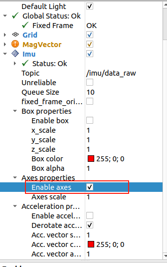

# ROS1 Application

**System configuration: ubuntu20\.04**

**ROS1**** Version: noetic**

### ROS1 Environment Configuration

1. **Set up the ****ROS1**** installation source**

```PowerShell
sudo sh -c '. /etc/lsb-release && echo "deb http://mirrors.tuna.tsinghua.edu.cn/ros/ubuntu/ `lsb_release -cs` main" > /etc/apt/sources.list.d/ros-latest.list'
```

2. **Set the Key**

```PowerShell
sudo apt-key adv --keyserver 'hkp://keyserver.ubuntu.com:80' --recv-key C1CF6E31E6BADE8868B172B4F42ED6FBAB17C654
```

```Plain Text
sudo apt update
```

3. **Install ROS1 (official download)**

```PowerShell
sudo apt install ros-noetic-desktop-full
```

Download and install ROS1 with proxy acceleration

wget http://fishros\.com/install \-O fishros \&\& \. fishros

4. **Configure environment variables**

```Plain Text
echo "source /opt/ros/noetic/setup.bash">> ~/.bashrc
```

```PowerShell
source ~/.bashrc
```

### Connect the Device to the Virtual Machine

1. **Check the device**

```PowerShell
ll /dev/ttyUSB*
```

2. **Create port mapping**

```PowerShell
sudo gedit /etc/udev/rules.d/99-serial-imu.rules
```

3. **Fill in the mapping file content**

```PowerShell
KERNEL=="ttyUSB*", ATTRS{idVendor}=="1a86", ATTRS{idProduct}=="7523", MODE:="0777", SYMLINK+="imu-serial"
```

4. **Save and exit, run the command to make the rules take effect**

```PowerShell
sudo udevadm trigger
```

```Plain Text
sudo service udev reload
```

```Plain Text
sudo service udev restart
```

5. **Verify**

```PowerShell
ll /dev/imu-serial
```

```Bash
sudo usermod -aG dialout ash
```

### Import the Prepared Compressed Package

1. **In the same directory level on Feishu there is** [IMU\_ROS1\.zip](https://juxitech.feishu.cn/wiki/BcWGwW2yDiXex9k6qjTcleTvnPb)

2. **After extracting, transfer it to the virtual machine via file transfer software**

3. **Install the IMU\_Library library**

```PowerShell
cd IMU_ROS1
# After downloading and extracting the IMU_ROS1 archive, enter the IMU_Library directory and run the following commands
cd IMU_Library

# Install the library and its dependencies
pip install -e .

# Or install using setup.py
python setup.py install
```

### Installing Python-related Libraries

```PowerShell
sudo pip3 install pyserial
sudo pip3 install smbus2
```

**If there is a rendering problem, execute the following commands**

```PowerShell
sudo apt-get install ros-noetic-imu-filter-madgwick
sudo apt-get install ros-noetic-rviz-imu-plugin
```

### Build the ROS1 Project

1. **Open a new terminal in the /home directory and create a new ros1 workspace**

```PowerShell
mkdir imu_ros1
cd imu_ros1
mkdir src
cd src/
catkin_init_workspace
```

2. **Copy the transferred IMU\_ROS1 folder to the \~/imu\_ros1/src/ directory**

```PowerShell
# Copy the IMU_ROS1 folder into the newly created src directory
cp -r ~/IMU_ROS1 ~/imu_ros1/src
cd ~/imu_ros1
catkin_make
```

3. **Write the working directory \~/imu\_ros1 into the environment variables**

```PowerShell
# Edit ~/.bashrc
sudo gedit ~/.bashrc

# Append the following command to the end
source ~/imu_ros1/devel/setup.bash

source ~/.bashrc
```

### Start the ROS1 Node

1. **Open a terminal and enter roscore to start the node**

```PowerShell
# Start roscore
roscore

# Open a new terminal, set up the environment, and start the node
source ~/imu_ros1/devel/setup.bash
```

2. **Add executable permissions to the Python script (key)**

Enter the `scripts` directory where the script is located, and execute the `chmod +x` command to grant executable permissions (`+x` means add execute, adding execute permission):

```PowerShell
# Enter the directory containing imu_driver.py (use your actual path)
cd ~/imu_ros1/src/IMU_ROS1/scripts/ 

# Grant execute permission (only needs to be run once, takes effect permanently)
chmod +x imu_driver.py
chmod +x mag_visualizer.py
```

Return to the imu\_ros1 folder and run imu\_driver\.py

```Plain Text
cd ~/imu_ros1
```

```Plain Text
rosrun IMU_ROS1 imu_driver.py
```

### IMU Data Printing

1. **Open a new terminal and view the imu topics**

```PowerShell
# List all currently published topics
rostopic list
```

2. **Print topic data**

```PowerShell
# Print raw IMU data
rostopic echo /imu/data_raw

# Print magnetometer data
rostopic echo /imu/mag
```

### RViz Visualization

1. **Run the command to start rviz****\(\)**

```PowerShell
roslaunch IMU_ROS1 imu_display.launch
```

### FAQ

1. If the node fails to open when starting, please try the following commands

```PowerShell
# Run in the ~/imu_ros1 directory
source devel/setup.bash

# Port number issues
sudo chmod 666 /dev/imu-serial
```

2. In the RVIZ visualization the three axes are displayed very small; re-check Enable axes




