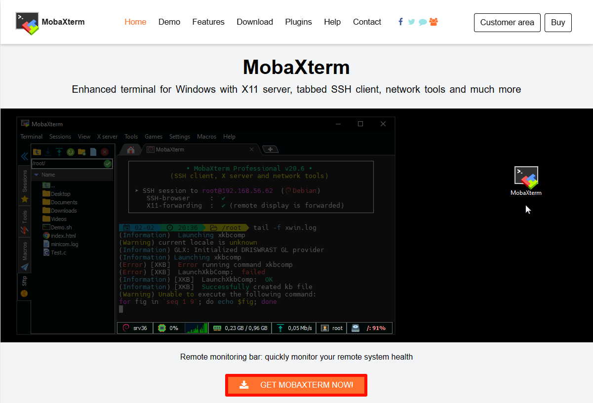
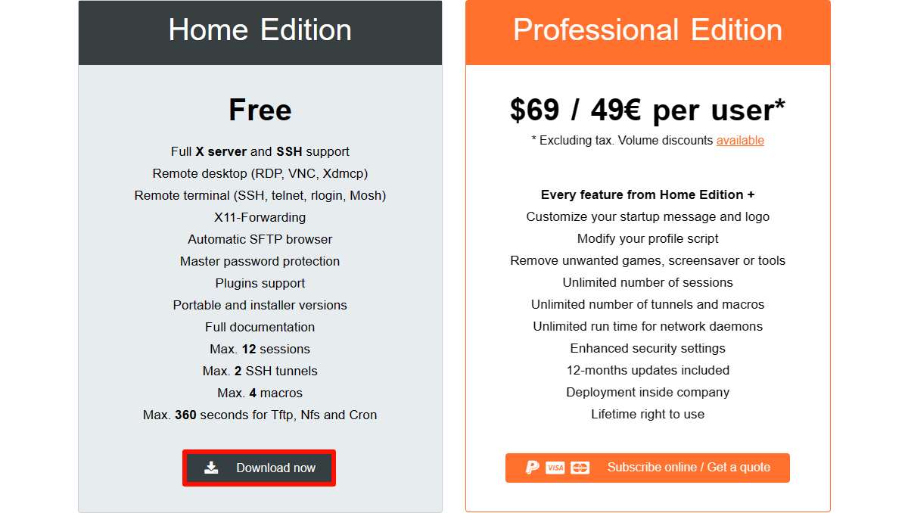
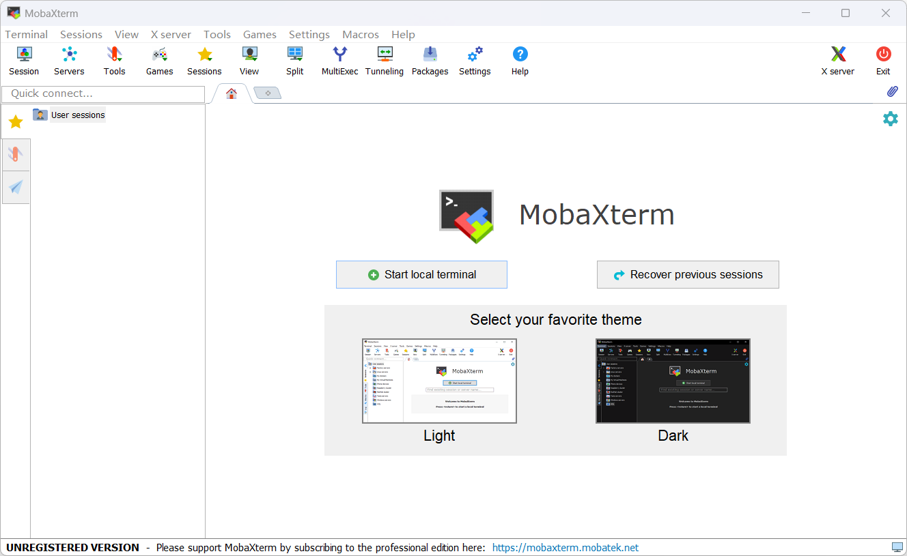

# Remote File Transfer

# [Remote File Transfer](https://juxitech.feishu.cn/docx/OAICdMDl9ozdDjx92uocVYrcnQq#OAICdMDl9ozdDjx92uocVYrcnQq)

[1. MobaXterm](https://juxitech.feishu.cn/docx/OAICdMDl9ozdDjx92uocVYrcnQq#doxcn6Xj5FnZdC8Xc7WirMMH1ob)

[2. MobaXterm Installation](https://juxitech.feishu.cn/docx/OAICdMDl9ozdDjx92uocVYrcnQq#doxcnhziIgp0c1zlNjRYXoF8qQd)

[2\.1. Download MobaXterm](https://juxitech.feishu.cn/docx/OAICdMDl9ozdDjx92uocVYrcnQq#doxcnKFBDKQBtCsUo6OslblLvRd)

[2\.2. Install MobaXterm](https://juxitech.feishu.cn/docx/OAICdMDl9ozdDjx92uocVYrcnQq#doxcnShWWp90NBCbz0VWkpDMTjW)

[3. Using MobaXterm](https://juxitech.feishu.cn/docx/OAICdMDl9ozdDjx92uocVYrcnQq#doxcnTFGoxRBZ8Eszi1NVvBXlGg)

[4. MobaXterm: SFTP Remote](https://juxitech.feishu.cn/docx/OAICdMDl9ozdDjx92uocVYrcnQq#doxcnQj3cuCUnWzEuT4GNupwpeh)

## 1. MobaXterm

MobaXterm is a powerful remote tool that integrates remote tools such as SHH, VNC, and FTP.

## 2. MobaXterm Installation

Official website: [https://mobaxterm\.mobatek\.net/](https://mobaxterm.mobatek.net/)

### 2\.1. Download MobaXterm

Choose the free version to download:

Choose the installable version to download:

### 2\.2. Install MobaXterm

Extract the compressed package downloaded from the official website, and open the `MobaXterm_installer_24.4.msi` file to install:

Agree to the agreement:

Select the software installation location: the default location is recommended

Formal installation:

Complete the installation:

## 3. Using MobaXterm

Find the `MobaXterm` icon on the desktop and open it:

## 4. MobaXterm: SSH Remote

Select `Session` → `SSH` : fill in the remote device IP and username

For example:

Default information of the Jetson board:

Username: juxi

Password: juxi

Note: When MobaXterm uses SSH remote, it will automatically use SFTP remote login in the sidebar

