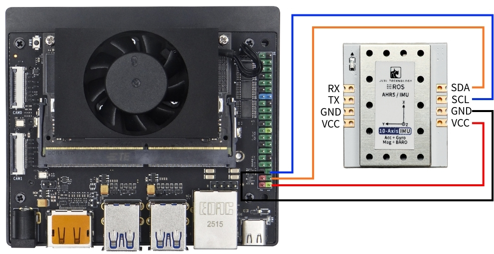
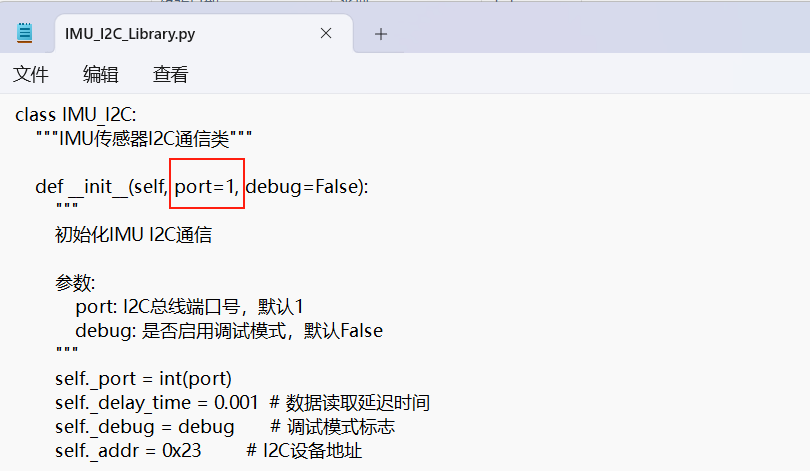

# Serie Jetson

## 1\.Conexión del dispositivo

Este tutorial toma como ejemplo la placa Jetson Orin NX.

Conecte el sensor de actitud IMU a la interfaz I2C de la Jetson Orin NX según se muestra en la figura siguiente.




## 2\.Consulta del estado del dispositivo

En primer lugar, instale I2Ctool; introduzca en el terminal:

```PowerShell
sudo apt-get update
sudo apt-get install -y i2c-tools
```

Consultar el dispositivo I2C

```PowerShell
sudo i2cdetect -y -r -a 7
```


## 3\.Instalación de la biblioteca de controladores

3\.1**Instalar las bibliotecas de python necesarias para el código**

```PowerShell
sudo apt update
sudo apt install -y python3-serial
sudo apt install -y python3-smbus2
```

3\.2Transferir archivos

[IMU\_ROS2\.zip](/downloads/IMU_ROS2.zip)

Si aún no sabe cómo usar MobaXterm para transferir archivos, consulte la siguiente página web con el método detallado de instalación y uso de MobaXterm: [Transferencia remota de archivos](https://juxitech.feishu.cn/wiki/KB0Jw2o6Wis9f0ksyeFceVmgnfd)

Arrastre los archivos descomprimidos a la Raspberry Pi 5 mediante el software MobaXterm.


## 4\.Consulta de los datos de la imu

**Entre en el directorio \~/IMU\_Library y ejecute el archivo IMU\_Serial\_Library\.py**

```PowerShell
cd ~/imu_ros2/src/IMU_ROS2/IMU_Library

# Ejecutar el archivo de impresión de datos del IMU
python3 -m IMU_Library.IMU_I2C_Library
```


Nota: lo anterior corresponde a la lectura de datos de una IMU de 10 ejes; la de 6 ejes no dispone de datos de magnetómetro (Magnetometer) ni de barómetro (Barometer), y la de 9 ejes no dispone de datos de barómetro (Barometer).

## **5\.Calibración de la IMU**

**Entre en el directorio \~/IMU\_Library y ejecute el archivo imu\_calibration\_tool\.py**

```PowerShell
cd ~/IMU_Library

# Ejecutar el archivo de código de calibración del IMU --calibración de comunicación I2C
# Ejecutar todas las calibraciones (completa, magnetómetro, temperatura)
python3 -m IMU_Library.imu_calibration_tool --mode i2c --port 7

# Solo calibración completa
python3-m IMU_Library.imu_calibration_tool --mode i2c --port 7 --calibrate imu

# Solo calibración del magnetómetro
python3-m IMU_Library.imu_calibration_tool --mode i2c --port 7 --calibrate mag

# Solo calibración de temperatura
python3-m IMU_Library.imu_calibration_tool --mode i2c --port 7 --calibrate temp
```


## 6\.Notas

Al usar la placa de la serie orin, es necesario modificar el número del bus I2C según la situación real; la posición de la modificación se muestra en la figura siguiente. Normalmente es el bus número 7.




