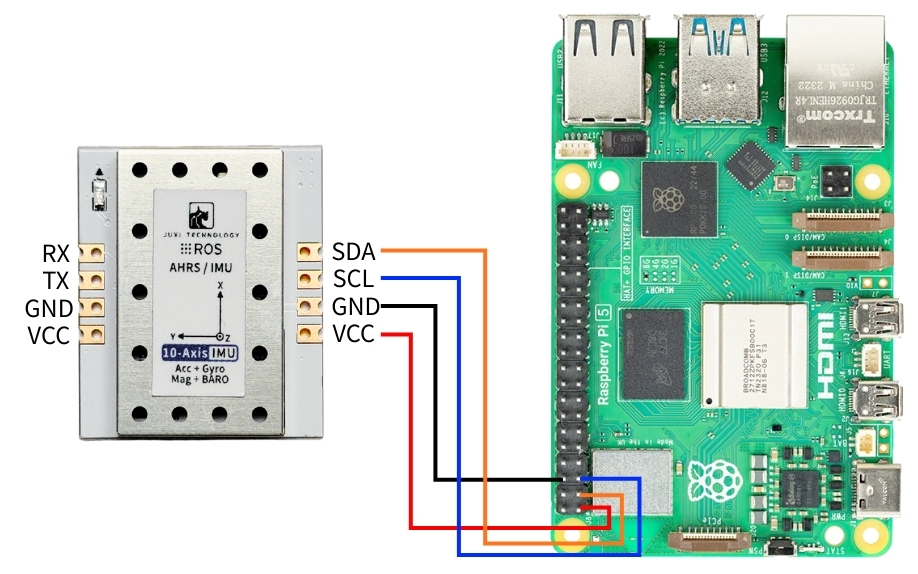
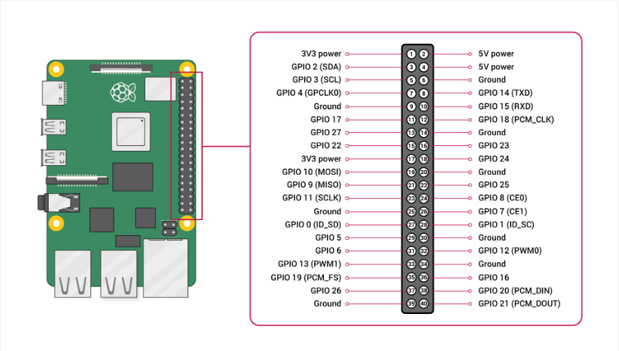

# Raspberry Pi 5

## 1\.Conexión del dispositivo

Este tutorial toma como ejemplo la placa Raspberry Pi 5 y la imagen oficial de 64 bits.

Conecte el sensor de actitud IMU a la interfaz I2C de la Raspberry Pi 5 según se muestra en la figura siguiente.





## 2\.Consulta del estado del dispositivo

En primer lugar, instale I2Ctool; introduzca en el terminal:

```PowerShell
sudo apt-get update
sudo apt-get install -y i2c-tools
```

Consultar el dispositivo I2C

```PowerShell
sudo i2cdetect -y -r -a 1
```


## 3\.Instalación de la biblioteca de controladores

3\.1**Instalar las bibliotecas de python necesarias para el código**

```PowerShell
sudo apt update
sudo apt install -y python3-serial
sudo apt install -y python3-smbus2
```

3\.2Transferir archivos

[IMU\_ROS2\.zip](/downloads/IMU_ROS2.zip)

Si aún no sabe cómo usar MobaXterm para transferir archivos, consulte la siguiente página web con el método detallado de instalación y uso de MobaXterm: [Transferencia remota de archivos](https://juxitech.feishu.cn/wiki/KB0Jw2o6Wis9f0ksyeFceVmgnfd)

Arrastre los archivos descomprimidos a la Raspberry Pi 5 mediante el software MobaXterm.


## 4\.Consulta de los datos de la imu

**Entre en el directorio \~/IMU\_Library y ejecute el archivo IMU\_Serial\_Library\.py**

```PowerShell
cd ~/imu_ros2/src/IMU_ROS1/IMU_Library

# Ejecutar el archivo de impresión de datos del IMU
python3 -m IMU_Library.IMU_I2C_Library
```


Nota: lo anterior corresponde a la lectura de datos de una IMU de 10 ejes; la de 6 ejes no dispone de datos de magnetómetro (Magnetometer) ni de barómetro (Barometer), y la de 9 ejes no dispone de datos de barómetro (Barometer).

## **5\.Calibración de la IMU**

**Entre en el directorio \~/IMU\_Library y ejecute el archivo imu\_calibration\_tool\.py**

```PowerShell
cd ~/IMU_Library

# Ejecutar el archivo de código de calibración del IMU --calibración de comunicación I2C
# Ejecutar todas las calibraciones (completa, magnetómetro, temperatura)
python3 -m IMU_Library.imu_calibration_tool --mode i2c --port 1

# Solo calibración completa
python3-m IMU_Library.imu_calibration_tool --mode i2c --port 1 --calibrate imu

# Solo calibración del magnetómetro
python3-m IMU_Library.imu_calibration_tool --mode i2c --port 1 --calibrate mag

# Solo calibración de temperatura
python3-m IMU_Library.imu_calibration_tool --mode i2c --port 1 --calibrate temp
```


## 6\.Notas

La Raspberry Pi 5 requiere habilitar previamente el pin i2c.

La operación de habilitación es la siguiente:

Ejecute el comando en el terminal

```PowerShell
sudo raspi-config
```

Seleccione con las teclas de dirección del teclado y, una vez seleccionado, pulse la tecla Enter para entrar


Seleccione I2C y, una vez seleccionado, pulse la tecla Enter para entrar,


Tras seleccionar I2C, pulse la tecla Enter, use las teclas de dirección para seleccionar Yes y pulse de nuevo Eneter para confirmar.


Pulse la tecla Enter para confirmar


Use las teclas de dirección para seleccionar Finish, luego pulse la tecla Enter para salir de la configuración.


