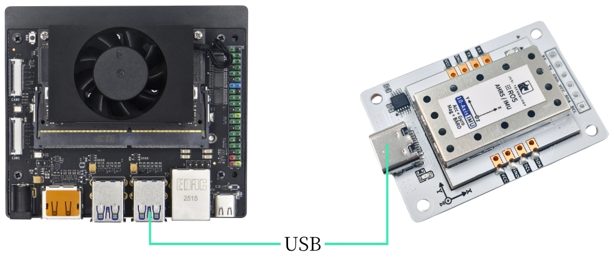
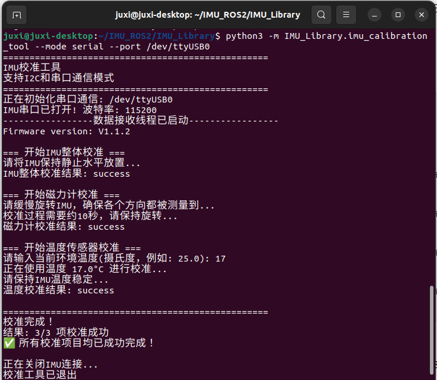

# Serie Jetson

## 1\.Conexión del dispositivo

Este tutorial toma como ejemplo la placa Jetson orin nx.

Conecte el sensor de actitud IMU al USB del controlador principal mediante un cable type\-c.



## 2\.Consulta del estado del dispositivo

Consultar el id del dispositivo

```PowerShell
lsusb
```

Consultar el número de dispositivo

```PowerShell
ls -l /dev/ttyU*
```


Configurar la asignación de puertos

```Bash
# Para evitar que el puerto cambie tras conectarlo y desconectarlo, configure la asignación de puertos
sudo gedit /etc/udev/rules.d/99-serial-imu.rules

# Si aparece un mensaje de que no existe el comando gedit, instalarlo primero
sudo apt install gedit

# Rellenar el contenido de la asignación
KERNEL=="ttyUSB*", ATTRS{idVendor}=="1a86", ATTRS{idProduct}=="7523", MODE:="0777", SYMLINK+="imu-serial"

# Descripción de los parámetros:
`--mode`: 通信模式，可选值为`serial`(串口)或`i2c`
`--port`: 串口名(如`/dev/ttyUSB0`)或I2C端口号(如`7`)
`--rate`: 数据打印频率(Hz)，默认10Hz
`--debug`: 启用调试模式，显示详细信息

# Guardar y salir, ejecutar el comando para que las reglas surtan efecto
sudo udevadm trigger
sudo service udev reload
sudo service udev restart

# Verificar
ll /dev/imu-serial

# Ejemplo de salida:
lrwxrwxrwx 1 root root 7 1月 22 10:00 /dev/imu-serial -> ttyUSB0
```

## 3\.Instalación de la biblioteca de controladores

**3\.1Instalar las bibliotecas de python necesarias para el código**

```PowerShell
sudo apt update
sudo apt install -y python3-serial
sudo apt install -y python3-smbus2
```

**3\.2Transferir archivos**

[IMU\_ROS2\.zip](/downloads/IMU_ROS2.zip)

Si aún no sabe cómo usar MobaXterm para transferir archivos, consulte la siguiente página web con el método detallado de instalación y uso de MobaXterm: [Transferencia remota de archivos](https://juxitech.feishu.cn/wiki/KB0Jw2o6Wis9f0ksyeFceVmgnfd)

Arrastre los archivos descomprimidos a la Jetson mediante el software MobaXterm.


## 4\.Consulta de los datos de la imu

**Entre en el directorio \~/IMU\_Library y ejecute el archivo IMU\_Serial\_Library\.py**

```PowerShell
cd ~/IMU_ROS2/IMU_Library

# Ejecutar el archivo de impresión de datos del IMU
python3 -m IMU_Library.IMU_Serial_Library
```


Nota: lo anterior corresponde a la lectura de datos de una IMU de 10 ejes; la de 6 ejes no dispone de datos de magnetómetro (Magnetometer) ni de barómetro (Barometer), y la de 9 ejes no dispone de datos de barómetro (Barometer).

## **5\.Calibración de la IMU**

**Entre en el directorio \~/IMU\_Library y ejecute el archivo imu\_calibration\_tool\.py**

```PowerShell
cd ~/IMU_Library

# Ejecutar el archivo de código de calibración del IMU --calibración de comunicación por puerto serie
# Ejecutar todas las calibraciones (completa, magnetómetro, temperatura)
python3 -m IMU_Library.imu_calibration_tool --mode serial --port /dev/imu-serial

# Solo calibración completa
python3 -m IMU_Library.imu_calibration_tool --mode serial --port /dev/imu-serial --calibrate imu

# Solo calibración del magnetómetro
python3 -m IMU_Library.imu_calibration_tool --mode serial --port /dev/imu-serial --calibrate mag

# Solo calibración de temperatura
python3 -m IMU_Library.imu_calibration_tool --mode serial --port /dev/imu-serial --calibrate temp
```



## 6\.Notas

Si se puede consultar el ID del dispositivo pero no el número de dispositivo, puede consultar los siguientes comandos para instalar el controlador ch34x

```PowerShell
sudo apt remove brltty
git clone https://github.com/clhchan/CH341SER.git
cd CH341SER
make -j6
sudo make install
sudo modprobe ch34x
```


