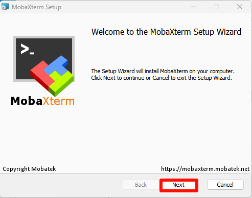
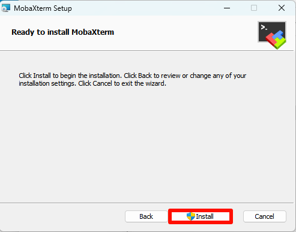
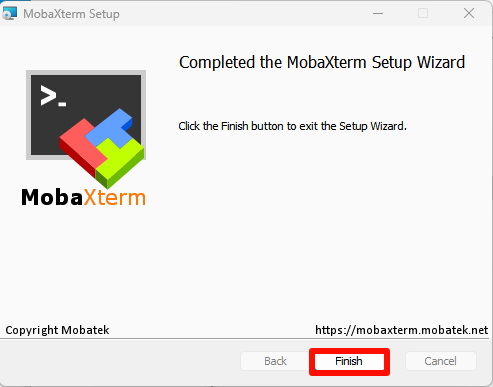
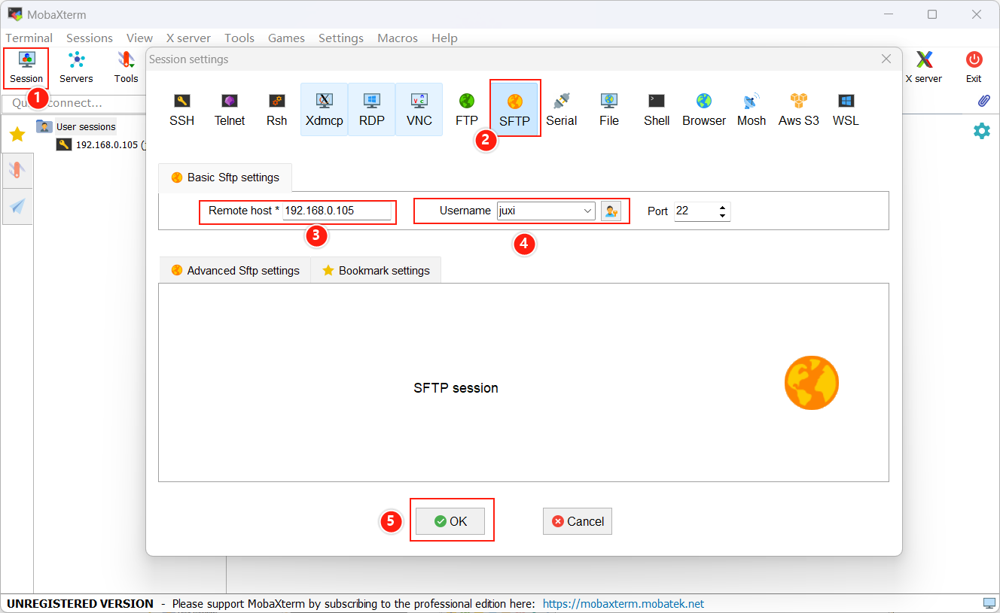
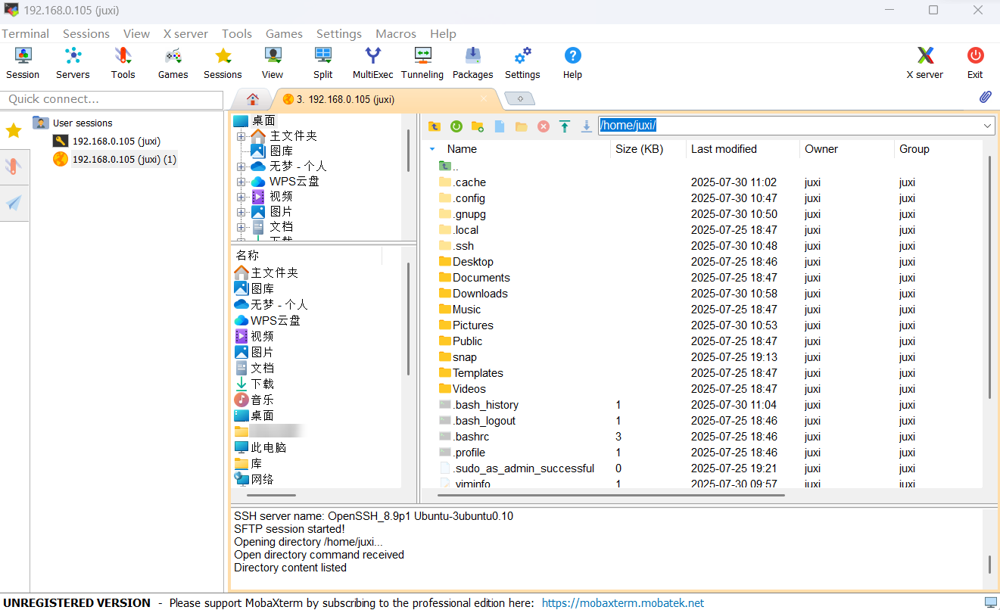

# Transferencia remota de archivos

# [Transferencia remota de archivos](https://juxitech.feishu.cn/docx/OAICdMDl9ozdDjx92uocVYrcnQq#OAICdMDl9ozdDjx92uocVYrcnQq)

[1. MobaXterm](https://juxitech.feishu.cn/docx/OAICdMDl9ozdDjx92uocVYrcnQq#doxcn6Xj5FnZdC8Xc7WirMMH1ob)

[2. Instalación de MobaXterm](https://juxitech.feishu.cn/docx/OAICdMDl9ozdDjx92uocVYrcnQq#doxcnhziIgp0c1zlNjRYXoF8qQd)

[2\.1. Descarga de MobaXterm](https://juxitech.feishu.cn/docx/OAICdMDl9ozdDjx92uocVYrcnQq#doxcnKFBDKQBtCsUo6OslblLvRd)

[2\.2. Instalación de MobaXterm](https://juxitech.feishu.cn/docx/OAICdMDl9ozdDjx92uocVYrcnQq#doxcnShWWp90NBCbz0VWkpDMTjW)

[3. Uso de MobaXterm](https://juxitech.feishu.cn/docx/OAICdMDl9ozdDjx92uocVYrcnQq#doxcnTFGoxRBZ8Eszi1NVvBXlGg)

[4. MobaXterm: SFTP remoto](https://juxitech.feishu.cn/docx/OAICdMDl9ozdDjx92uocVYrcnQq#doxcnQj3cuCUnWzEuT4GNupwpeh)

## 1. MobaXterm

MobaXterm es una potente herramienta remota que integra herramientas remotas como SHH, VNC, FTP, etc.

## 2. Instalación de MobaXterm

Sitio web oficial: [https://mobaxterm\.mobatek\.net/](https://mobaxterm.mobatek.net/)

### 2\.1. Descarga de MobaXterm

Seleccione la versión gratuita para descargar:

Seleccione la versión de instalación para descargar:

### 2\.2. Instalación de MobaXterm

Descomprima el paquete comprimido descargado del sitio web oficial y abra el archivo `MobaXterm_installer_24.4.msi` para instalarlo:

Acepte el acuerdo:

Seleccione la ubicación de instalación del software: se recomienda la ubicación predeterminada

Instalación formal:

Instalación completada:

## 3. Uso de MobaXterm

Busque en el escritorio el icono de `MobaXterm` y ábralo:

## 4. MobaXterm: SSH remoto

Seleccione `Session` → `SSH`: rellene la IP y el nombre de usuario del dispositivo remoto

Por ejemplo:

Información predeterminada de la placa Jetson:

Nombre de usuario: juxi

Contraseña: juxi

Nota: al usar SSH remoto con MobaXterm, en la barra lateral se iniciará sesión automáticamente por SFTP remoto

