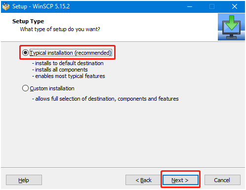
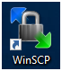

# Transfert de fichiers SSH

## 1. Installation du programme WInSCP

[Logiciel de connexion à distance\.zip](/downloads/远程登录软件.zip)

Téléchargez et décompressez, double-cliquez pour ouvrir le programme et lancez l'installation, cliquez sur Accept pour accepter le contrat, puis suivez simplement les instructions pour installer.





Cliquez sur Finish pour terminer l'installation.


Vous pouvez voir qu'une icône WinSCP est apparue sur le bureau



## 2. Transfert de fichiers à distance via SSH

Après avoir ouvert le logiciel WinSCP, l'interface de connexion suivante apparaît.

File protocol : sélectionnez SFTP comme protocole de fichier, Host name : adresse IP, Port number : 22 par défaut suffit, User name : nom d'utilisateur, Password : mot de passe de connexion.

Après avoir saisi les informations correctes, vous pouvez cliquer sur Save pour enregistrer les informations saisies, afin de ne pas avoir à les ressaisir lors de la prochaine connexion.


Après avoir cliqué sur Login et réussi la connexion, l'interface suivante s'affiche : à gauche les dossiers de l'ordinateur win, à droite les dossiers du nano.


Le transfert de fichiers comporte trois modes d'opération. Le premier consiste à glisser directement le fichier de gauche à droite, ou de droite à gauche, et le système copie automatiquement une copie du fichier pour la transférer.

Le deuxième consiste à sélectionner le fichier avec la souris, puis à appuyer sur la touche F5 ; le fichier sélectionné est alors copié de l'autre côté.

Le troisième consiste à sélectionner le fichier et à cliquer avec le bouton droit de la souris ; s'il s'agit d'un transfert de l'ordinateur win vers le nano, cliquez sur upload,


Une invite s'affiche ; vous pouvez choisir de ne plus l'afficher, puis cliquer sur OK, et le fichier est transféré automatiquement.


Si vous transférez un fichier du nano vers l'ordinateur win, faites un clic droit sur le fichier sélectionné et choisissez Download


Remarque : le transfert de fichiers nécessite que l'ordinateur et la carte mère soient sur le même réseau local, et que le service SSH soit déjà activé sur le Raspberry Pi. Parfois, en cas d'échec du transfert de fichier, il s'agit généralement d'une permission insuffisante du côté de la carte mère ; nous devons simplement accorder les permissions maximales.

```Plain Text
chmod 777 目录名 
```


