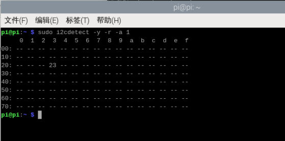
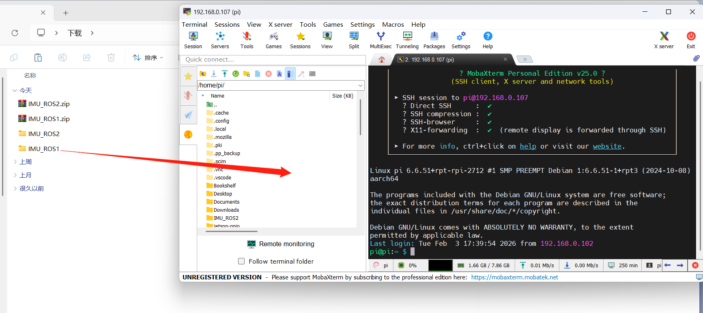
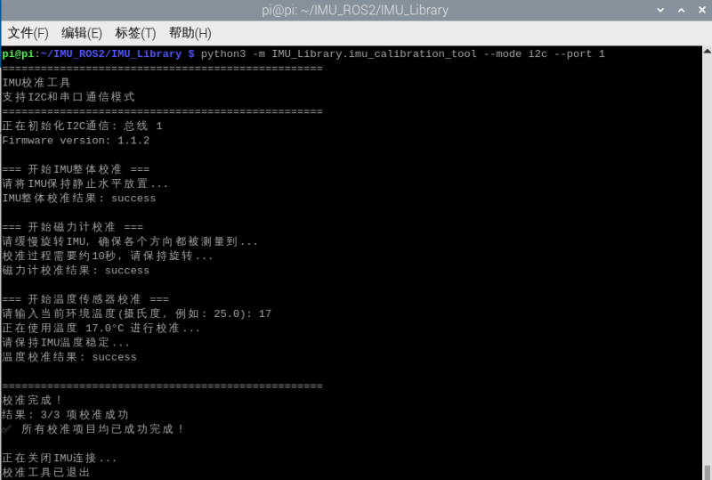
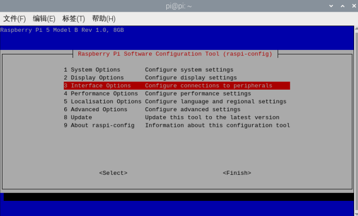
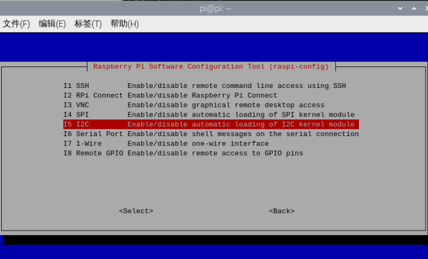
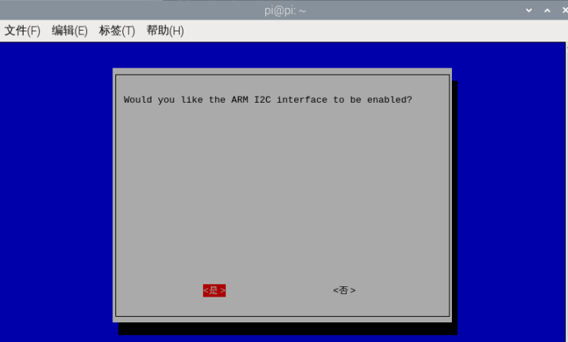
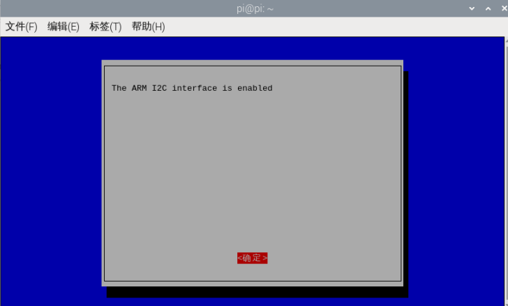
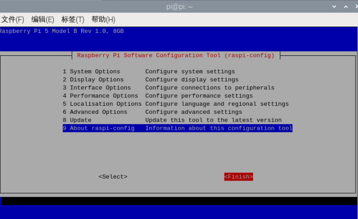

# Raspberry Pi 5

## 1\.Connexion des appareils

Ce tutoriel prend comme exemple la carte mère Raspberry Pi 5 et l'image officielle 64 bits.

Connectez le capteur d'attitude IMU à l'interface I2C de la Raspberry Pi 5 comme indiqué dans la figure ci-dessous.


## 2\.Vérification de l'état de l'appareil

Installez d'abord I2Ctool, saisissez dans le terminal :

```PowerShell
sudo apt-get update
sudo apt-get install -y i2c-tools
```

Vérifier les appareils I2C

```PowerShell
sudo i2cdetect -y -r -a 1
```



## 3\.Installation de la bibliothèque de pilotes

3\.1**Installation des bibliothèques python nécessaires au code**

```PowerShell
sudo apt update
sudo apt install -y python3-serial
sudo apt install -y python3-smbus2
```

3\.2Transfert de fichiers

[IMU\_ROS2\.zip](/downloads/IMU_ROS2.zip)

Si vous ne savez pas encore utiliser MobaXterm pour transférer des fichiers, veuillez consulter la page web suivante pour l'installation détaillée et la méthode d'utilisation de MobaXterm : [Transfert de fichiers à distance](https://juxitech.feishu.cn/wiki/KB0Jw2o6Wis9f0ksyeFceVmgnfd)

À l'aide du logiciel MobaXterm, glissez les fichiers décompressés vers la Raspberry Pi 5.



## 4\.Consultation des données IMU

**Entrez dans le répertoire \~/IMU\_Library, exécutez le fichier IMU\_Serial\_Library\.py**

```PowerShell
cd ~/imu_ros2/src/IMU_ROS1/IMU_Library

# Exécuter le fichier d'affichage des données IMU
python3 -m IMU_Library.IMU_I2C_Library
```


Remarque : ce qui précède correspond à la lecture des données d'un IMU 10 axes ; le 6 axes n'a pas de données de magnétomètre (Magnetometer) ni de baromètre (Barometer), le 9 axes n'a pas de données de baromètre (Barometer).

## **5\.Calibrage de l'IMU**

**Entrez dans le répertoire \~/IMU\_Library, exécutez le fichier imu\_calibration\_tool\.py**

```PowerShell
cd ~/IMU_Library

# Exécuter le fichier de calibration IMU --calibration de communication I2C
# Effectuer toutes les calibrations (globale, magnétomètre, température)
python3 -m IMU_Library.imu_calibration_tool --mode i2c --port 1

# Calibration globale uniquement
python3-m IMU_Library.imu_calibration_tool --mode i2c --port 1 --calibrate imu

# Calibration du magnétomètre uniquement
python3-m IMU_Library.imu_calibration_tool --mode i2c --port 1 --calibrate mag

# Calibration de température uniquement
python3-m IMU_Library.imu_calibration_tool --mode i2c --port 1 --calibrate temp
```



## 6\.Points d'attention

La Raspberry Pi 5 nécessite d'activer au préalable la broche i2c.

L'opération d'activation est la suivante :

Exécutez la commande dans le terminal

```PowerShell
sudo raspi-config
```

Sélectionnez à l'aide des touches fléchées du clavier, puis appuyez sur la touche Enter du clavier pour entrer



Sélectionnez I2C, puis appuyez sur la touche Enter du clavier pour entrer,



Après avoir sélectionné I2C, appuyez sur la touche Enter du clavier, utilisez les touches fléchées pour sélectionner Yes, puis appuyez sur la touche Eneter pour confirmer.



Appuyez sur la touche Enter pour confirmer



Utilisez les touches fléchées pour sélectionner Finish, puis appuyez sur la touche Enter pour quitter la configuration.




