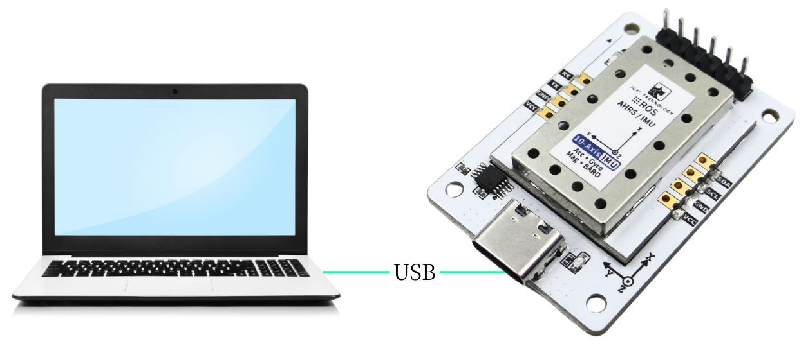

# Communication PC

**Remarque : si le port série n'est pas reconnu, veuillez installer le pilote ch340**

1. Le capteur d'attitude IMU est connecté à l'ordinateur via un câble de données type\-c

2. Consultez les données du port série

Configurez l'assistant de port série comme indiqué dans la figure ci-dessous,

Les données imprimées par le port série sont des données non traitées ; pour la signification précise des données, veuillez vous référer au document « **Protocole de communication** ».

[Module IMU\-protocole de communication série et I2C\.xlsx](图片和附件/IMU模块-串口与I2C通讯协议.xlsx)

