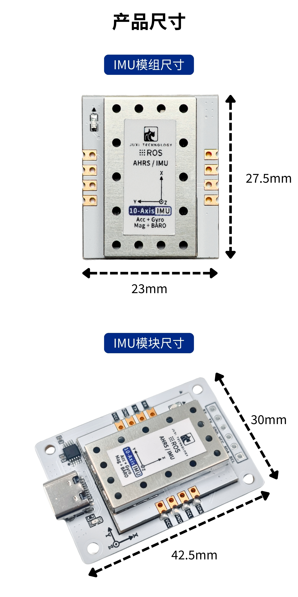

# Tutorial d'uso del modulo IMU

# Introduzione al modulo IMU

Il sensore di assetto IMU ad alta precisione integra un **processore a 32 bit ad alte prestazioni da 72 MHz**, in grado di eseguire il calcolo dell'assetto e la compensazione dinamica in tempo reale, con una frequenza di aggiornamento dei dati fino a 100 Hz, unendo i vantaggi di una risposta rapida e di un'uscita stabile. Supporta la doppia modalità di comunicazione IIC e seriale, è compatibile con microcontrollori e unità principali Linux e può integrarsi perfettamente con il sistema ROS; è ampiamente applicabile a scenari ad alte prestazioni come il controllo del movimento dei robot, la stabilizzazione dell'assetto dei droni e la navigazione e il posizionamento intelligenti.

# 1. Introduzione alle versioni

## Descrizione delle funzioni dei pin

# 2. Parametri del prodotto

# 3. Parametri di prestazione del sensore

Parametri di prestazione dei dati IMU

Parametri di prestazione dei dati di navigazione

Parametri di prestazione del barometro

# 4. Parametri dimensionali

