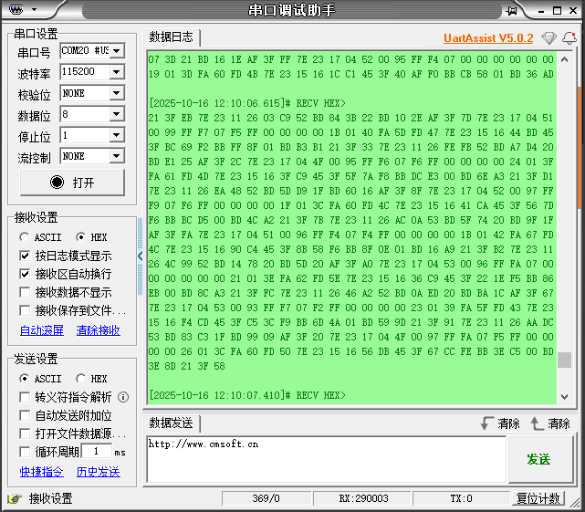

# Comunicazione tramite PC

**Nota: se la porta seriale non viene riconosciuta, installare il driver ch340**

1. Il sensore di assetto IMU si collega al computer tramite un cavo dati type\-c

2. Visualizzare i dati della porta seriale

Configurare l'assistente di porta seriale come mostrato nella figura seguente:

La porta seriale stampa dati non elaborati; per il significato specifico dei dati fare riferimento al documento «**Protocollo di comunicazione**».

[Modulo IMU\-Protocollo di comunicazione seriale e I2C\.xlsx](../../../../Multi-master%20communication%20case/Serial&I2C%20Communication%20Protocol.xlsx)

