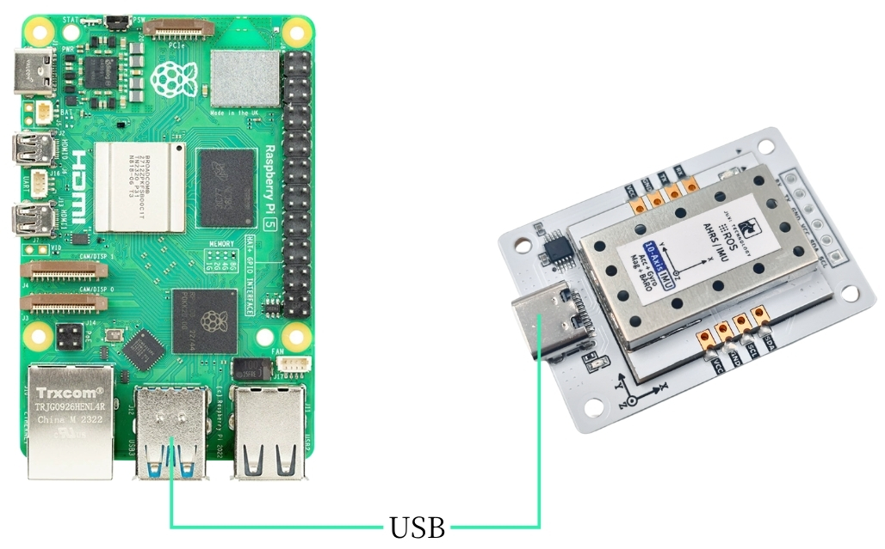
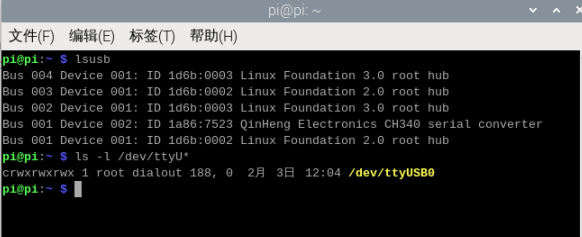
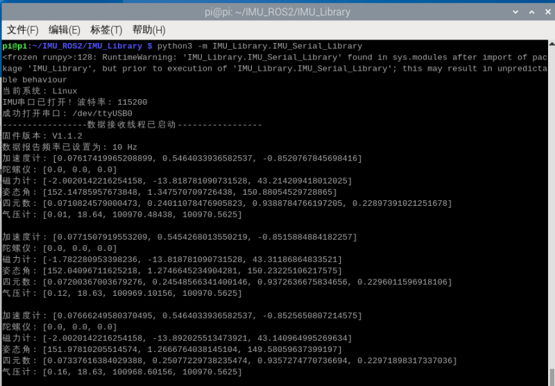

# Raspberry Pi 5

## 1\.Collegamento del dispositivo

Questo tutorial prende come esempio la scheda Raspberry Pi 5 e l'immagine ufficiale a 64 bit.

Collegare il sensore di assetto IMU alla USB dell'unità principale tramite un cavo type\-c.



## 2\.Visualizzazione dello stato del dispositivo

Visualizzare l'id del dispositivo

```PowerShell
lsusb
```

Visualizzare il numero di dispositivo

```PowerShell
ls -l /dev/ttyU*
```



Impostare la mappatura delle porte

```Bash
# Per evitare che la porta cambi dopo il collegamento e lo scollegamento, impostare la mappatura delle porte
sudo gedit /etc/udev/rules.d/99-serial-imu.rules

# Se compare un messaggio che indica l'assenza del comando gedit, installarlo prima
sudo apt install gedit

# Compilare il contenuto della mappatura
KERNEL=="ttyUSB*", ATTRS{idVendor}=="1a86", ATTRS{idProduct}=="7523", MODE:="0777", SYMLINK+="imu-serial"

# Descrizione dei parametri:
`--mode`: 通信模式，可选值为`serial`(串口)或`i2c`
`--port`: 串口名(如`/dev/ttyUSB0`)或I2C端口号(如`7`)
`--rate`: 数据打印频率(Hz)，默认10Hz
`--debug`: 启用调试模式，显示详细信息

# Salvare e uscire, eseguire il comando per rendere effettive le regole
sudo udevadm trigger
sudo service udev reload
sudo service udev restart

# Verificare
ll /dev/imu-serial

# Esempio di output:
lrwxrwxrwx 1 root root 7 1月 22 10:00 /dev/imu-serial -> ttyUSB0
```

## 3\.Installazione della libreria di driver

**3\.1Installare le librerie python necessarie per il codice**

```PowerShell
sudo apt update
sudo apt install -y python3-serial
sudo apt install -y python3-smbus2
```

**3\.2Trasferire i file**

[IMU\_ROS2\.zip](/downloads/IMU_ROS2.zip)

Se non si sa ancora come usare MobaXterm per trasferire file, consultare la seguente pagina web con il metodo dettagliato di installazione e utilizzo di MobaXterm: [Trasferimento remoto di file](https://juxitech.feishu.cn/wiki/KB0Jw2o6Wis9f0ksyeFceVmgnfd)

Trascinare i file decompressi sulla Raspberry Pi 5 tramite il software MobaXterm.


## 4\.Visualizzazione dei dati della imu

**Entrare nella directory \~/IMU\_Library ed eseguire il file IMU\_Serial\_Library\.py**

```PowerShell
cd ~/IMU_ROS2/IMU_Library

# Eseguire il file di stampa dei dati dell'IMU
python3 -m IMU_Library.IMU_Serial_Library
```



Nota: quanto sopra corrisponde alla lettura dei dati di una IMU a 10 assi; quella a 6 assi non dispone dei dati del magnetometro (Magnetometer) e del barometro (Barometer), mentre quella a 9 assi non dispone dei dati del barometro (Barometer).

## **5\.Calibrazione della IMU**

**Entrare nella directory \~/IMU\_Library ed eseguire il file imu\_calibration\_tool\.py**

```PowerShell
cd ~/IMU_Library

# Eseguire il file di codice di calibrazione dell'IMU --calibrazione della comunicazione seriale
# Eseguire tutte le calibrazioni (completa, magnetometro, temperatura)
python3 -m IMU_Library.imu_calibration_tool --mode serial --port /dev/imu-serial

# Solo calibrazione completa
python3 -m IMU_Library.imu_calibration_tool --mode serial --port /dev/imu-serial --calibrate imu

# Solo calibrazione del magnetometro
python3 -m IMU_Library.imu_calibration_tool --mode serial --port /dev/imu-serial --calibrate mag

# Solo calibrazione della temperatura
python3 -m IMU_Library.imu_calibration_tool --mode serial --port /dev/imu-serial --calibrate temp
```

## 6\.Note

Se è possibile visualizzare l'ID del dispositivo ma non il numero di dispositivo, è possibile fare riferimento ai seguenti comandi per installare il driver ch34x

```PowerShell
sudo apt remove brltty
git clone https://github.com/clhchan/CH341SER.git
cd CH341SER
make -j6
sudo make install
sudo modprobe ch34x
```


