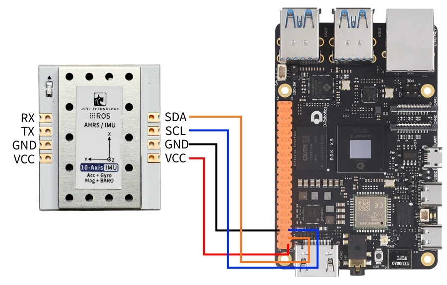
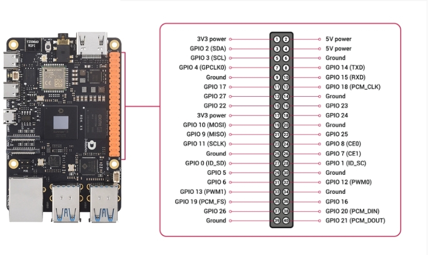
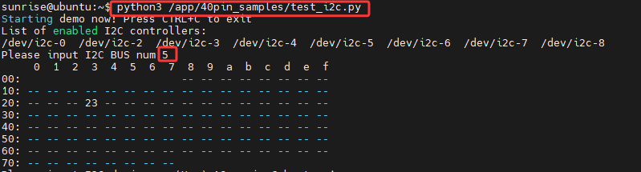
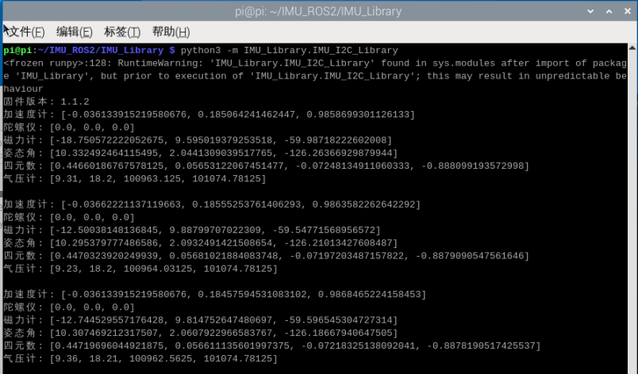
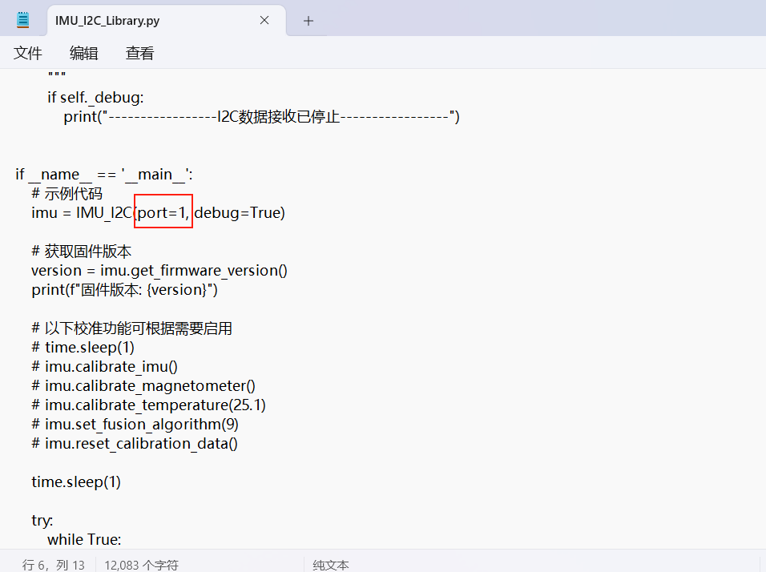

# RDKシリーズ

## 1\.デバイスの接続

本チュートリアルではRDK X5ボードの？バージョンのイメージを例にします。

IMU姿勢センサーを下図のようにRDK X5のI2Cインターフェースに接続します。





## 2\.デバイス状態の確認

I2Cデバイスを確認します

```PowerShell
python3 /app/40pin_samples/test_i2c.py
```



## 3\.ドライバライブラリのインストール

3\.1**コードに必要なPythonライブラリのインストール**

```PowerShell
sudo apt update
sudo apt install -y python3-serial
sudo apt install -y python3-smbus2
```

3\.2 ファイルの転送

[IMU\_ROS2\.zip](/downloads/IMU_ROS2.zip)

MobaXtermでのファイル転送方法がまだわからない方は、以下のWebページでMobaXtermの詳細なインストールと操作方法を確認してください：[ファイルリモート転送](https://juxitech.feishu.cn/wiki/KB0Jw2o6Wis9f0ksyeFceVmgnfd)

MobaXtermソフトで 解凍後のファイル を Raspberry Pi 5 にドラッグします。


## 4\.IMUデータの確認

**\~/IMU\_Libraryディレクトリに入り、IMU\_Serial\_Library\.pyファイルを実行します**

```PowerShell
cd ~/imu_ros1/src/IMU_ROS1/IMU_Library
# または
cd ~/imu_ros2/src/IMU_ROS2/IMU_Library

# IMU データ出力ファイルを実行
python3 -m IMU_Library.IMU_I2C_Library
```



注意：以上は10軸IMUのデータ読み取りです。6軸には磁力計（Magnetometer）と気圧計（Barometer）のデータがなく、9軸には気圧計（Barometer）のデータがありません。

## **5\.IMUキャリブレーション**

**\~/IMU\_Libraryディレクトリに入り、imu\_calibration\_tool\.pyファイルを実行します**

```PowerShell
cd ~/IMU_Library

# IMU キャリブレーションコードファイルを実行 --I2C 通信用キャリブレーション
# すべてのキャリブレーションを実行（全体、磁力計、温度）
python3 -m IMU_Library.imu_calibration_tool --mode i2c --port 0

# 全体キャリブレーションのみ
python3-m IMU_Library.imu_calibration_tool --mode i2c --port 0 --calibrate imu

# 磁力計キャリブレーションのみ
python3-m IMU_Library.imu_calibration_tool --mode i2c --port 0 --calibrate mag

# 温度キャリブレーションのみ
python3-m IMU_Library.imu_calibration_tool --mode i2c --port 0 --calibrate temp
```


## 6\.注意事項

RDK X5ボードを使用する場合、実際の状況に応じてI2Cバス番号を変更する必要があります。変更箇所は下図のとおりです。通常は0番バスです。





