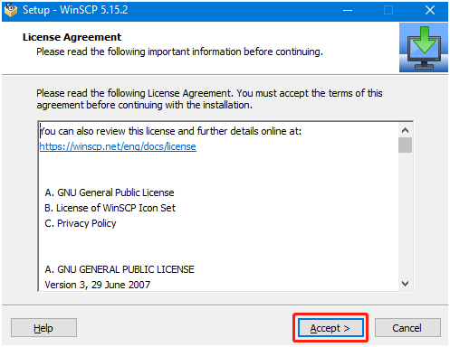
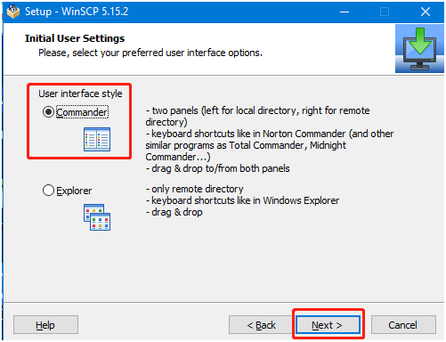
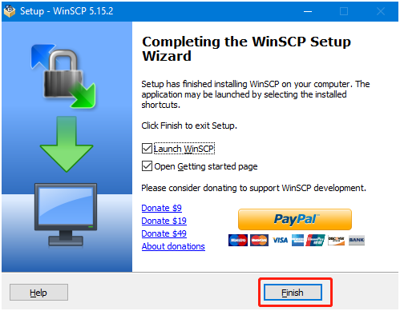
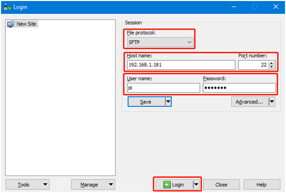
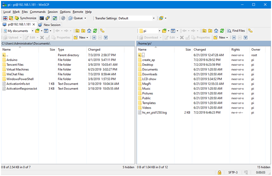
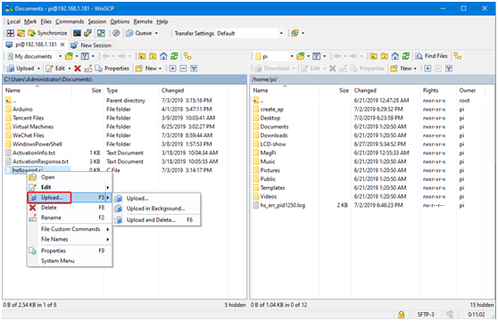
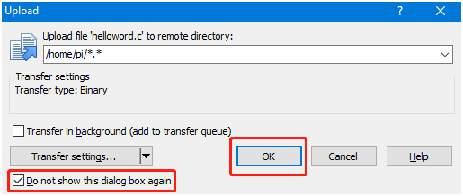
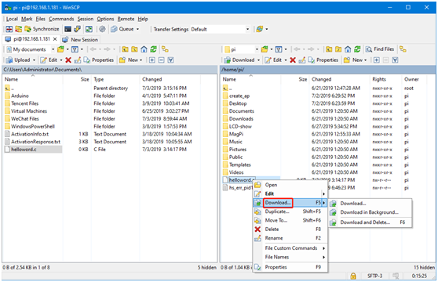

# SSH文件传输

## 一、WInSCP程序安装

[远程登录软件\.zip](/downloads/远程登录软件.zip)

下载并解压，双击打开程序并且开始安装，点击Accept接受协议，然后跟着提示安装就好。






点击Finish完成安装。



可以看到桌面多了一个WinSCP的图标


## 二、SSH远程传文件

打开WinSCP软件后出现以下登录界面。

File protocol：文件协议选择SFTP，Host name：IP地址，Port number：默认22就可以，User name：用户名，Password：登录密码。

输入正确的信息后可以点击Save保存一下填写的信息，下次登录的时候不用重复输入。



点击Login登录成功后会显示以下界面，左边的是win电脑的文件夹，右边的是nano的文件夹。



文件传输有三种操作方式，第一种是直接把文件从左边拉到右边，或者从右边拉到左边，系统会自动复制一份文件传输过去。

第二种是鼠标选中文件，然后按一下F5键，则被选中的文件会复制一份到另一边。

第三种是选中文件点击鼠标右键，如果是从win电脑传到nano则点击upload，



会弹出一个提示，可以选择不再提示，并且点击OK，则文件自动传输过去。



如果从nano传文件到win电脑上，则按鼠标右键选中文件，选择Download



注意：文件传输需要电脑和主板在同一个局域网下，并且树莓派已开启SSH服务才可以进行。有时若遇见传输文件失败一般是主板这边的权限不够，我们只需要给予最高权限。

```Plain Text
chmod 777 目录名 
```


