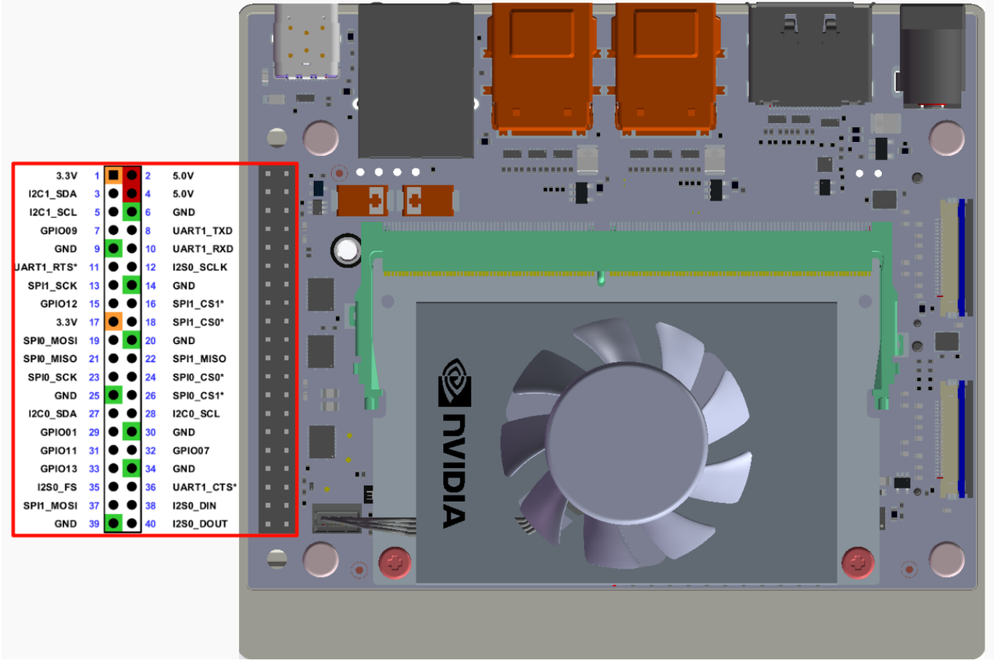

# Jetson系列

## 1\.连接设备

本教程以Jetson Orin NX主板为例。

将IMU姿态传感器按照下图连接到Jetson Orin NX的I2C接口。




## 2\.查看设备状态

首先安装 I2Ctool，终端输入：

```PowerShell
sudo apt-get update
sudo apt-get install -y i2c-tools
```

查看I2C设备

```PowerShell
sudo i2cdetect -y -r -a 7
```


## 3\.安装驱动库

3\.1**安装代码所需python库**

```PowerShell
sudo apt update
sudo apt install -y python3-serial
sudo apt install -y python3-smbus2
```

3\.2传输文件

[IMU\_ROS2\.zip](/downloads/IMU_ROS2.zip)

如果还不会使用MobaXterm传输文件的朋友，请查看以下网页MobaXterm详细安装和操作方法：[文件远程传输](https://juxitech.feishu.cn/wiki/KB0Jw2o6Wis9f0ksyeFceVmgnfd)

通过MobaXterm软件将 解压后的文件 拖入 树莓派5 上。


## 4\.查看imu数据

**进入 \~/IMU\_Library目录，运行IMU\_Serial\_Library\.py文件**

```PowerShell
cd ~/imu_ros2/src/IMU_ROS2/IMU_Library

# 运行 IMU 数据打印文件
python3 -m IMU_Library.IMU_I2C_Library
```


注意：以上为10轴IMU的数据读取，6轴无磁力计（Magnetometer）与气压计（Barometer）数据，9轴无气压计（Barometer）数据。

## **5\.IMU校准**

**进入 \~/IMU\_Library目录，运行imu\_calibration\_tool\.py文件**

```PowerShell
cd ~/IMU_Library

# 运行 IMU 校准代码文件 --I2C通讯校准
# 执行所有校准（整体、磁力计、温度）
python3 -m IMU_Library.imu_calibration_tool --mode i2c --port 7

# 仅整体校准
python3-m IMU_Library.imu_calibration_tool --mode i2c --port 7 --calibrate imu

# 仅磁力计校准
python3-m IMU_Library.imu_calibration_tool --mode i2c --port 7 --calibrate mag

# 仅温度校准
python3-m IMU_Library.imu_calibration_tool --mode i2c --port 7 --calibrate temp
```


## 6\.注意事项

使用 orin系列主板 时，需要根据实际情况修改I2C的总线的序号，修改位置如下图。通常是7号总线


