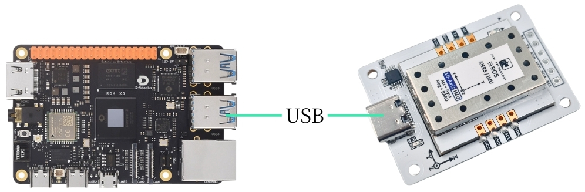

# RDK系列

## 1\.連接裝置

本教程以RDK X5主板的版本的鏡像為例。

將IMU姿態傳感器通過type\-c線插在主控的USB上。



## 2\.查看裝置狀態

查看裝置id

```PowerShell
lsusb
```

查看裝置號

```PowerShell
ls -l /dev/ttyU*
```


設定連接埠映射

```Bash
# 防止插拔後連接埠變更，請設定連接埠映射
sudo gedit /etc/udev/rules.d/99-serial-imu.rules

# 如出現沒有gedit命令相關內容，先下載安裝
sudo apt install gedit

# 填寫映射內容
KERNEL=="ttyUSB*", ATTRS{idVendor}=="1a86", ATTRS{idProduct}=="7523", MODE:="0777", SYMLINK+="imu-serial"

# 參數說明：
`--mode`: 通信模式，可选值为`serial`(串口)或`i2c`
`--port`: 串口名(如`/dev/ttyUSB0`)或I2C端口号(如`7`)
`--rate`: 数据打印频率(Hz)，默认10Hz
`--debug`: 启用调试模式，显示详细信息

# 保存退出，運行命令使規則生效
sudo udevadm trigger
sudo service udev reload
sudo service udev restart

# 驗證
ll /dev/imu-serial

# 輸出示例：
lrwxrwxrwx 1 root root 7 1月 22 10:00 /dev/imu-serial -> ttyUSB0
```

## 3\.安裝驅動庫

**3\.1安裝代碼所需python庫**

```PowerShell
sudo apt update
sudo apt install -y python3-serial
sudo apt install -y python3-smbus2
```

**3\.2傳輸檔案**

[IMU\_ROS2\.zip](/downloads/IMU_ROS2.zip)

如果還不會使用MobaXterm傳輸檔案的朋友，請查看以下網頁MobaXterm詳細安裝和操作方法：[檔案遠程傳輸](https://juxitech.feishu.cn/wiki/KB0Jw2o6Wis9f0ksyeFceVmgnfd)

通過MobaXterm軟件將 解壓後的檔案 拖入 RDK X5 上。


## 4\.查看imu數據

**進入 \~/IMU\_Library目錄，運行IMU\_Serial\_Library\.py檔案**

```PowerShell
cd ~/IMU_ROS2/IMU_Library

# 運行 IMU 數據打印檔案
python3 -m IMU_Library.IMU_Serial_Library
```


注意：以上為10軸IMU的數據讀取，6軸無磁力計（Magnetometer）與氣壓計（Barometer）數據，9軸無氣壓計（Barometer）數據。

## **5\.IMU校準**

**進入 \~/IMU\_Library目錄，運行imu\_calibration\_tool\.py檔案**

```PowerShell
cd ~/IMU_Library

# 運行 IMU 校準程式碼檔案 --串口通訊校準
# 執行所有校準（整體、磁力計、溫度）
python3 -m IMU_Library.imu_calibration_tool --mode serial --port /dev/imu-serial

# 僅整體校準
python3 -m IMU_Library.imu_calibration_tool --mode serial --port /dev/imu-serial --calibrate imu

# 僅磁力計校準
python3 -m IMU_Library.imu_calibration_tool --mode serial --port /dev/imu-serial --calibrate mag

# 僅溫度校準
python3 -m IMU_Library.imu_calibration_tool --mode serial --port /dev/imu-serial --calibrate temp
```

## 6\.注意事項

如果可以查到裝置ID，但是無法查到裝置號，可以參考下面的命令安裝ch34x驅動

```PowerShell
sudo apt remove brltty
git clone https://github.com/clhchan/CH341SER.git
cd CH341SER
make -j6
sudo make install
sudo modprobe ch34x
```


